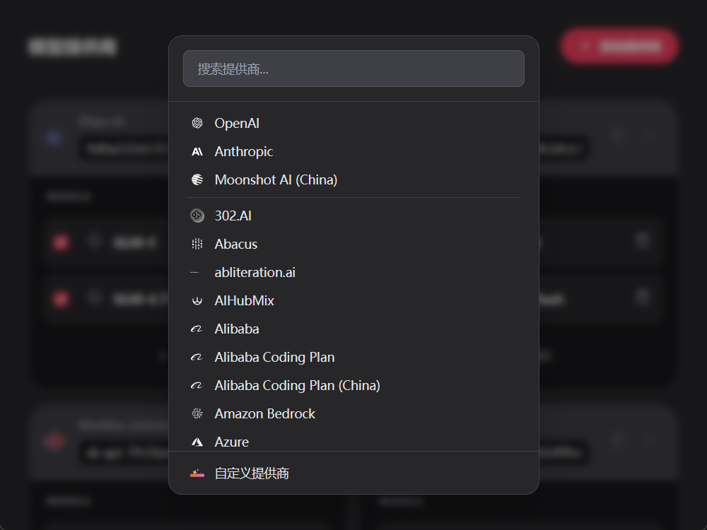
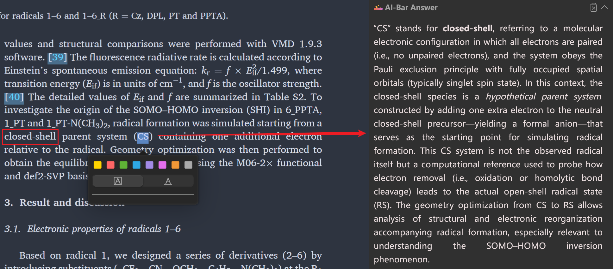
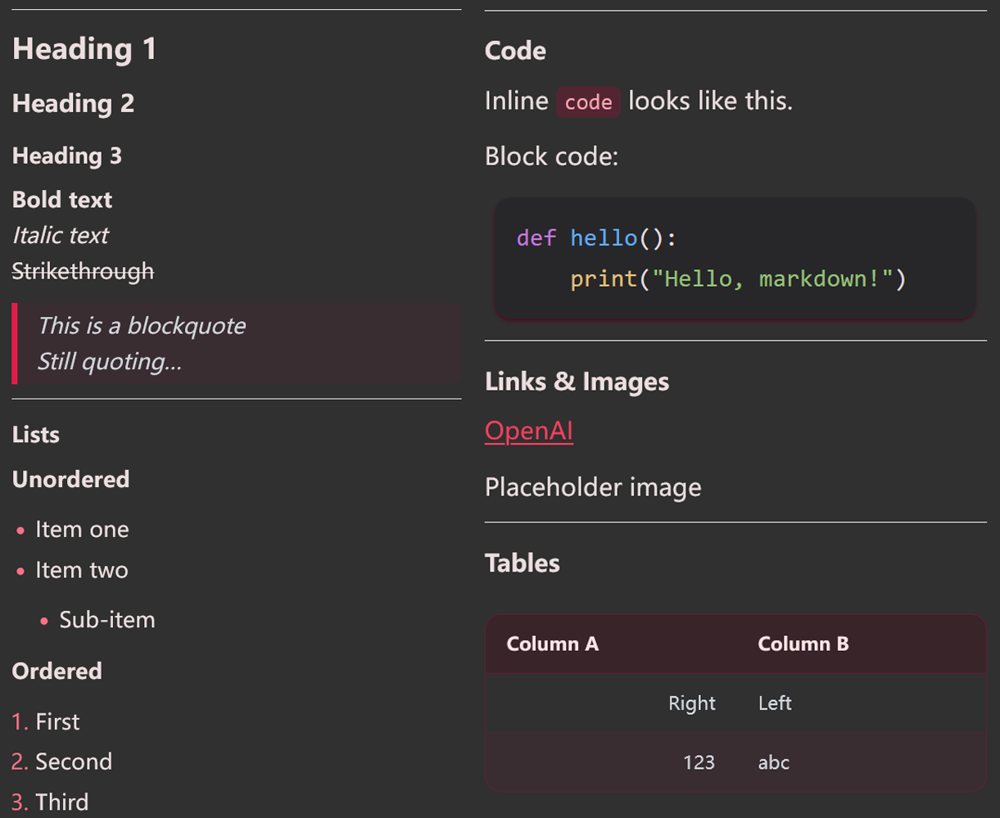

# Zotero AI Bar

[](https://www.zotero.org)
[](https://github.com/swcxito/zotero-ai-bar/releases)
[](LICENSE)

**English** | [简体中文](docs/README_zh-CN.md)

An AI reading companion for Zotero. Select text in a paper to explain, translate, clean copied text, summarize, or ask a question—then switch to full-document reading or an autonomous agent across your document and Zotero library when you need more context.

[Project website](https://zotero.fukeke.com) · [Documentation](https://zotero.fukeke.com/en/guides/install) · [Download the latest release](https://github.com/swcxito/zotero-ai-bar/releases/latest/download/zotero-ai-bar.xpi) · [All releases](https://github.com/swcxito/zotero-ai-bar/releases)


## Highlights

- **Selection toolbar in the PDF reader.** Select text to trigger **Explain**, **Translate** (structured word, abbreviation, and passage cards, with optional auto-translation, dedicated translation model, and separate translation tab), **Smart Copy** (strips PDF artifacts and converts formulas to LaTeX), **Summarize**, custom prompts, or a direct follow-up question with optional surrounding context.
- **Workspaces and chat modes.** Work in **Article Q&A** (bound to the open reader tab), **Global Assistant** (library-wide Agent mode that can also follow the active PDF), or a dedicated **Translation** tab. Switch between **Normal**, **Full Text**, and **Agent** modes, and dock the chat in the main-window sidebar or pop it out into a standalone window.
- **Agent tools for your library and papers.** In Agent mode, the model can search and read document text by page or line (`grep`, `read`), inspect your library structure and selected items (`glob`, `tree`, `get_selected_items`), capture PDF pages as images for visual analysis (`capture_page`, opening unopened PDFs in the background when needed), ask clarifying questions (`ask_user`), and search Crossref by title to import papers into Zotero with duplicate checks (`search_papers`, `add_paper`). When an item has multiple PDFs, the reading strategy can prefer the original file, let the model choose, or prompt you to pick manually.
- **API providers and local subscription runtimes.** Browse the built-in and `models.dev` catalog (OpenAI, Anthropic, Google Gemini, DeepSeek, OpenRouter, Alibaba Cloud, Volcano Engine, Zhipu, MiniMax, Moonshot, xAI, Azure, Amazon Bedrock, Google Vertex, or any OpenAI-compatible custom endpoint). You can also connect a **ChatGPT subscription** via the local Codex App Server runtime (with optional ChatGPT apps in Agent mode) or a **Claude subscription** via the local Claude Code CLI.
- **Rich rendering, citations, and visual input.** Capture regions from a PDF or paste up to 9 images into the composer. Responses render GFM Markdown, syntax-highlighted code blocks, tables, KaTeX math, and clickable Zotero citations (`[cite:...]`) that preview metadata on hover and jump to the cited PDF page or line. Select any part of a reply to copy it as Markdown (preserving tables and LaTeX) or plain text.
- **History, context compaction, and WebDAV sync.** Conversations are saved locally with favorites, renaming, turn navigation, per-response token usage, context-window tracking, and automatic context checkpoint compaction for long threads. Optional **WebDAV sync** merges chat history, custom prompts, provider/model configs, and settings across devices (re-linking items across libraries by item key, DOI, ISBN, or title/author/year).
- **Customizable interface.** Choose from six visual skins (**Rose**, **Paper**, **Abyss**, **Moss**, **Tactical**, **B&W**), adjust chat font size, and set per-session reasoning effort (`none` to `xhigh` / `max`).



## Install and get started

1. Download `zotero-ai-bar.xpi` from [the latest release](https://github.com/swcxito/zotero-ai-bar/releases/latest/download/zotero-ai-bar.xpi). Keep the `.xpi` file compressed.
2. In Zotero, open **Tools → Plugins** (or **Tools → Add-ons**), click the gear menu, and choose **Install Plugin From File…**.
3. Open **Edit → Settings → AI Bar**, click **Edit Models**, add an API provider or connect a local subscription runtime, and enable your models.
4. Open a PDF in the reader, select text to use the popup toolbar, or open the AI Bar sidebar / window to start chatting.

See the [installation guide](https://zotero.fukeke.com/en/guides/install) and [model setup guide](https://zotero.fukeke.com/en/guides/addmodel) for details. API and subscription usage is governed by your provider's account terms.

## Subscription runtime integrations & sync notes

- **ChatGPT subscription (Codex):** On macOS and Windows, AI Bar can launch a local Codex runtime (`0.154.0-alpha.6.2+`) over stdio and reuse your ChatGPT login, including optional connected ChatGPT apps in Agent mode. See [docs/codex-integration.md](docs/codex-integration.md) and [docs/codex-apps.md](docs/codex-apps.md).
- **Claude subscription (Claude Code):** AI Bar can invoke an installed official `claude` CLI signed in via `claude.ai`, exposing Zotero library tools in Agent mode through an in-process SDK MCP server while keeping built-in shell and file tools disabled. See [docs/claude-code-integration.md](docs/claude-code-integration.md).
- **WebDAV cloud sync:** Configure bidirectional merge, push, pull, or 30-minute auto-sync under **Settings → AI Bar → WebDAV Cloud Sync**. WebDAV app passwords are stored in Zotero's Login Manager; API key syncing is opt-in. See [docs/webdav-sync.md](docs/webdav-sync.md).

## Screenshots

| Reader actions                             | Context controls                                    | Rich responses                                            |
| ------------------------------------------ | --------------------------------------------------- | --------------------------------------------------------- |
|  |  |  |

## Development

Requires Node.js (22.18+ recommended), `pnpm` (`pnpm@10.28.0`), and Zotero 7+.

```bash
pnpm install --frozen-lockfile
pnpm build          # Bundle into .scaffold/build and run tsc --noEmit
pnpm start          # Start zotero-plugin dev server
pnpm lint:check     # Run Prettier and ESLint checks
pnpm test           # Run the Zotero integration test suite
pnpm test:codex     # Run Node-based Codex, WebDAV, and chat history tests
pnpm test:claude-code # Run Node-based Claude Code adapter and MCP tests
```

Contributions are welcome. See [CONTRIBUTING.md](CONTRIBUTING.md) ([中文](docs/CONTRIBUTING_zh-CN.md)) for guidelines.

## Compatibility and support

- Supports **Zotero 7 through 10**.
- Browse guides and settings references in the [documentation](https://zotero.fukeke.com), report bugs or request features in [GitHub Issues](https://github.com/swcxito/zotero-ai-bar/issues), and review changes in [GitHub Releases](https://github.com/swcxito/zotero-ai-bar/releases).

## Support development

If Zotero AI Bar helps your research, a GitHub star or sponsorship helps keep it maintained.

<a href="https://afdian.com/a/fukeke"></a>
<a href="https://www.buymeacoffee.com/fukeke"></a>

## Acknowledgements

Built with [Zotero](https://www.zotero.org), [Zotero Plugin Template](https://github.com/windingwind/zotero-plugin-template), [zotero-plugin-toolkit](https://github.com/windingwind/zotero-plugin-toolkit), [Vercel AI SDK](https://github.com/vercel/ai), and [models.dev](https://github.com/anomalyco/models.dev). Parts of the implementation were inspired by [Zotero PDF Translate](https://github.com/windingwind/zotero-pdf-translate) and [Zotero PDF2zh](https://github.com/guaguastandup/zotero-pdf2zh).

## License

Zotero AI Bar is licensed under [AGPL-3.0-or-later](LICENSE).
