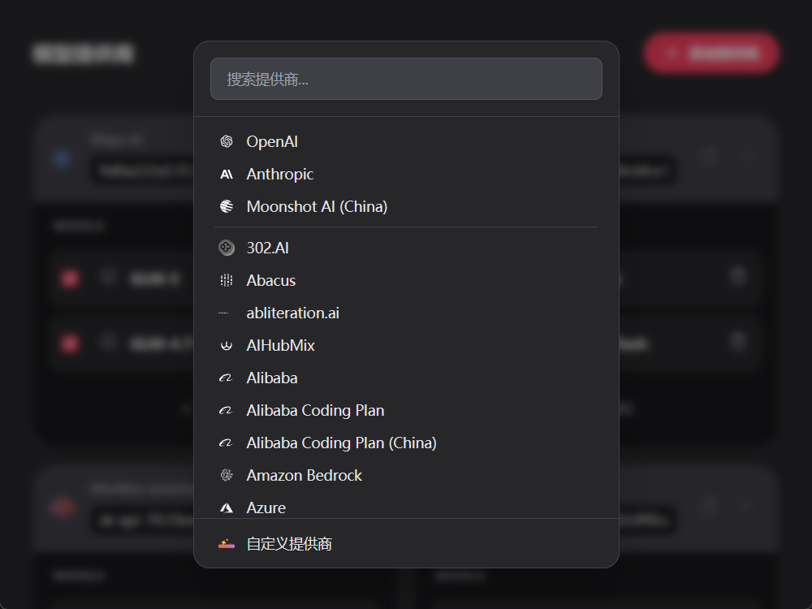
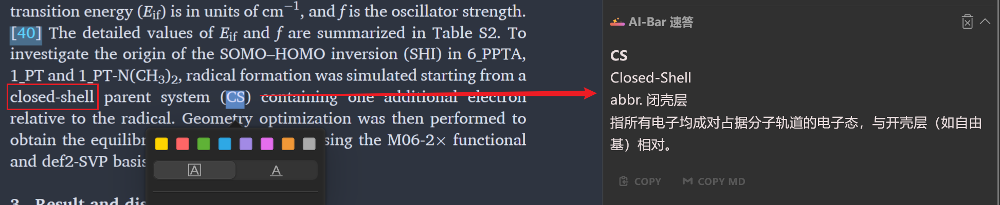
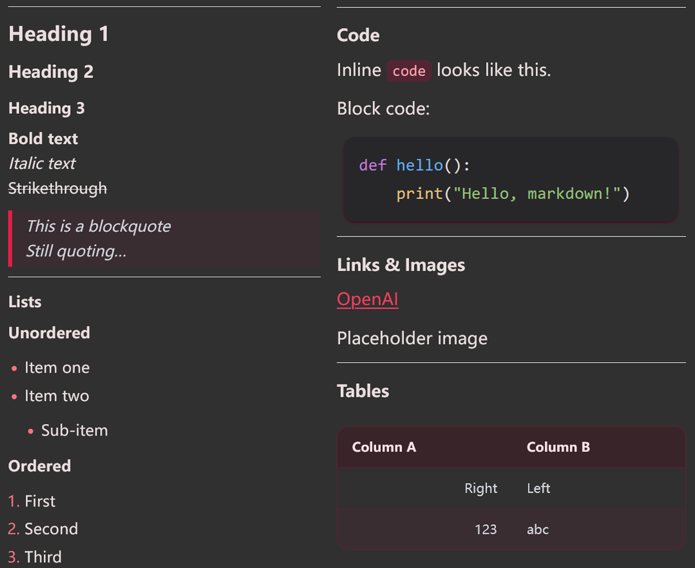

# Zotero AI Bar

[](https://www.zotero.org)
[](https://github.com/swcxito/zotero-ai-bar/releases)
[](../LICENSE)

[English](../README.md) | **简体中文**

Zotero AI Bar 是深植于 Zotero 的 AI 文献阅读与研究助手。在 PDF 阅读器中划选文本，即可一键解释、翻译、智能复制、总结或追问；也可切换到全文阅读或跨文库 Agent 模式，让 AI 主动检索文献、精读段落、截取页面图表并导入新论文。

[项目网站](https://zotero.fukeke.com/zh-cn/) · [使用文档](https://zotero.fukeke.com/zh-cn/guides/install) · [下载最新版本](https://github.com/swcxito/zotero-ai-bar/releases/latest/download/zotero-ai-bar.xpi) · [全部版本](https://github.com/swcxito/zotero-ai-bar/releases)


## 核心功能

- **PDF 阅读器划词工具栏。** 选中文本即可触发**解释**、**翻译**（支持单词多义项/音标、缩写展开与段落翻译卡片，可开启划词自动翻译、专用翻译模型及独立翻译标签页）、**智能复制**（自动清理 PDF 页眉页脚与断行噪声，并将数学符号转为 LaTeX 格式）、**总结**、自定义提示词或直接输入追问，并支持自动扩展选区前后文。
- **多工作区与三种对话模式。** 提供绑定当前阅读器标签页的**文章速答**、面向整个文库且可跟随当前打开 PDF 的**全局助理**，以及可选的**独立翻译**视图。支持在**普通**、**全文**与 **Agent** 模式间切换，可在主窗口右侧边栏与可置顶的独立聊天窗口之间自由停靠或弹出。
- **深入文库与 PDF 的 Agent 工具集。** 在 Agent 模式下，模型可按页或按行检索并读取文献全文（`grep`、`read`）、浏览分类树与当前选中文献（`glob`、`tree`、`get_selected_items`）、自动在后台打开或复用阅读器截取 PDF 页面供视觉模型分析图表公式（`capture_page`）、向用户发起澄清提问（`ask_user`），以及通过 Crossref 按标题检索 DOI、查重并自动导入文献与全文附件至「AI 下载文献」分类（`search_papers`、`add_paper`）。当条目下包含原文、译文等多个 PDF 时，支持「优先提供原文」「由模型选择」或「手动选择」三种读取策略。
- **多服务商 API 与本地订阅接入。** 内置并可在线同步 `models.dev` 模型目录（支持 OpenAI、Anthropic、Google Gemini、DeepSeek、OpenRouter、阿里云百炼、火山引擎、智谱、MiniMax、月之暗面 Kimi、xAI、Azure、Amazon Bedrock、Google Vertex、Qwen-MT 翻译模型及任意 OpenAI 兼容自定义端点）。同时支持通过本地 **Codex** 运行时接入 **ChatGPT 订阅**（含 Agent 模式下的 ChatGPT 已连接应用），或通过本地官方 **Claude Code CLI** 接入 **Claude 订阅**。
- **富文本渲染、文献引用跳转与视觉输入。** 支持在 PDF 页面框选区域截图或从剪贴板粘贴最多 9 张图片提问。回复支持 GFM Markdown、代码高亮与一键复制、表格、KaTeX 公式优化，以及悬停预览元数据、点击直接跳转到对应 PDF 页码或行号的文献引用标签（`[cite:...]`，右键可指定要打开的附件）。划选回复内容时，可浮动选择「复制 Markdown」（完整保留表格与 LaTeX 公式源码）或「复制纯文本」。
- **对话历史、上下文压缩与 WebDAV 云同步。** 本地持久化保存对话历史，支持收藏、重命名、右侧轮次快速定位导航、单次回复与上下文窗口 Token 占用统计，以及长对话超限前的自动摘要检查点压缩。提供 **WebDAV 云同步**（坚果云、Nextcloud 等），可跨设备双向合并对话历史、自定义提示词、模型配置与插件偏好设置，并通过 `itemKey`、DOI、ISBN 或「标题+作者+年份」自动重新关联不同设备上的同一文献。
- **个性化界面与外观皮肤。** 内置**经典（Rose）**、**纸页（Paper）**、**深海（Abyss）**、**苔绿（Moss）**、**机能（Tactical）**、**黑白（B&W）**六款主题皮肤，支持聊天字号调节、按会话调整思考强度（`关` 至 `极高` / `最高`），以及中文界面空白对话下的古典诗词展示。



## 安装与开始使用

1. 从[最新发布页](https://github.com/swcxito/zotero-ai-bar/releases/latest/download/zotero-ai-bar.xpi)下载 `zotero-ai-bar.xpi` 文件（请勿解压）。
2. 在 Zotero 中打开 **工具 → 插件**（或 **工具 → 附加组件**），点击右上角齿轮菜单并选择 **Install Plugin From File…（从文件安装插件…）**。
3. 打开 **编辑 → 设置 → AI 工具栏**，点击 **编辑模型**，添加 API 服务商（填写 API Key 并添加模型）或连接本地 ChatGPT / Claude Code 订阅。
4. 在阅读器中打开一篇 PDF 文献，划选文字使用弹出工具栏，或点击工具栏图标打开侧边栏 / 独立窗口开始对话。

详细图文步骤请参阅[安装指南](https://zotero.fukeke.com/zh-cn/guides/install)和[添加模型指南](https://zotero.fukeke.com/zh-cn/guides/addmodel)。模型服务的调用额度与费用由对应服务商按其账号条款计算。

## 本地订阅接入与云同步说明

- **ChatGPT 订阅接入（Codex）：** 在 macOS 和 Windows 上，插件可通过 stdio 启动本机已安装的 Codex 运行时（最低版本 `0.154.0-alpha.6.2`）并复用 ChatGPT 登录状态，支持在 Agent 模式中调用已连接的 ChatGPT 应用（如 Notion、GitHub 等）。详见 [Codex 订阅接入说明](codex-integration.md) 与 [Codex 应用接入说明](codex-apps.md)。
- **Claude 订阅接入（Claude Code）：** 插件可调用本机已登录 `claude.ai` 订阅的官方 `claude` 原生 CLI，在 Agent 模式下通过进程内 SDK MCP 服务仅向模型开放 Zotero 文库工具，关闭其自带的终端与本地文件工具。详见 [Claude Code 接入说明](claude-code-integration.md)。
- **WebDAV 云同步：** 在 **设置 → AI 工具栏 → WebDAV云同步** 中配置服务器地址与应用密码，支持双向合并、上传覆盖、拉取合并及启动/每 30 分钟自动同步。应用密码保存在 Zotero Login Manager 中，API 密钥默认不随云端同步。详见 [WebDAV 云同步说明](webdav-sync.md)。

## 界面预览

| 阅读器操作                          | 上下文设置                                   | 富文本回复                                   |
| ----------------------------------- | -------------------------------------------- | -------------------------------------------- |
|  |  |  |

## 本地开发与测试

开发环境需安装 Node.js（推荐 22.18+）、`pnpm`（`pnpm@10.28.0`）以及 Zotero 7+。

```bash
pnpm install --frozen-lockfile
pnpm build            # 打包 XPI 至 .scaffold/build 并执行 tsc --noEmit 类型检查
pnpm start            # 启动 zotero-plugin 开发调试服务
pnpm lint:check       # 运行 Prettier 与 ESLint 代码检查
pnpm test             # 运行 Zotero 集成测试套件
pnpm test:codex       # 运行基于 Node 的 Codex、WebDAV 与对话历史测试
pnpm test:claude-code # 运行基于 Node 的 Claude Code 适配器与 MCP 协议测试
```

欢迎提交 PR 或参与改进，开发规范详见 [CONTRIBUTING](../CONTRIBUTING.md)（[中文贡献指南](CONTRIBUTING_zh-CN.md)）。

## 兼容性与反馈

- 支持 **Zotero 7 至 10**。
- 安装与功能参考请查阅[项目文档](https://zotero.fukeke.com/zh-cn/)，Bug 反馈与功能建议请提交至 [GitHub Issues](https://github.com/swcxito/zotero-ai-bar/issues)，版本更新记录请查看 [GitHub Releases](https://github.com/swcxito/zotero-ai-bar/releases)。

## 支持开发

如果 Zotero AI Bar 对你的科研与阅读有帮助，欢迎点亮 GitHub ⭐ 或赞助项目，支持后续维护。

<a href="https://afdian.com/a/fukeke"></a>
<a href="https://www.buymeacoffee.com/fukeke"></a>

## 致谢

本项目基于 [Zotero](https://www.zotero.org)、[Zotero Plugin Template](https://github.com/windingwind/zotero-plugin-template)、[zotero-plugin-toolkit](https://github.com/windingwind/zotero-plugin-toolkit)、[Vercel AI SDK](https://github.com/vercel/ai) 和 [models.dev](https://github.com/anomalyco/models.dev) 构建，部分实现参考了 [Zotero PDF Translate](https://github.com/windingwind/zotero-pdf-translate) 与 [Zotero PDF2zh](https://github.com/guaguastandup/zotero-pdf2zh)。

## 许可证

本项目采用 [AGPL-3.0-or-later](../LICENSE) 许可证。
